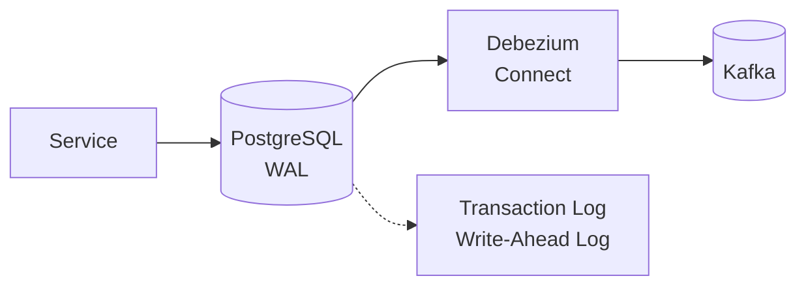

# ADR-0004: Change Data Capture (CDC)

## Status

Accepted, amended in [PIN-534](https://linear.app/pintail-consulting/issue/PIN-534/wire-debezium-cdc-into-cqrs-for-all-services)

**Amended 2026-11-14 ([PIN-534](https://linear.app/pintail-consulting/issue/PIN-534/wire-debezium-cdc-into-cqrs-for-all-services), PIN-545):** How change data capture works in every service is now settled, and the Decision below reflects it.

- **Outbox tables.** A service writes its events to an outbox table in the same transaction as its state change. Debezium's outbox event router publishes them to the existing topics, with unchanged keys and JSON payloads, so existing consumers keep working. Debezium does not capture the services' state tables.
- **Product captures tables directly.** Product has no write path: its catalog comes from Flyway seeds. Debezium captures the catalog tables, and the connector's first snapshot loads the seeded catalog into MongoDB. This is the one exception to the outbox rule.
- **Product's analytics events keep publishing directly.** `ProductViewed`, `SearchExecuted` and `FiltersApplied` are not state changes, so there is nothing to capture. They are the only domain-style events that bypass the outbox.
- **Connectors.** One connector per service database, registered automatically by the local stack ([ADR-0008](0008-debezium-cdc-connector.md)).
- **No polling relay.** The polling `OutboxRelay` is replaced by Debezium ([ADR-0022](0022-transactional-outbox-pattern.md)).
- **Identity's Redis-backed events.** Session, device and token-reuse events describe state that lives in Redis. Writing them to a PostgreSQL outbox gives them one path to Kafka, but not atomicity with the Redis change.

**Before PIN-534 (2026-10-21, PIN-386):** Debezium Connect runs in `docker-compose.yml`, but no service publishes its events through CDC. The only connector config, `docker/debezium/connectors/postgres-connector.json` (`acme-postgres-connector`), captures `acme_orders`, and nothing registers it automatically; you have to POST it to the Connect REST API by hand. Customer and order instead write events to a transactional outbox table that a scheduled `OutboxRelay` polls about once a second and sends to Kafka, which is the polling pattern described below. Product, shopping-cart, identity and notification publish straight to Kafka ([ADR-0042](0042-best-effort-event-publishing.md)). Customer's MongoDB read model is projected in-process by `CustomerReadModelProjector`, not fed by CDC ([ADR-0041](0041-per-service-persistence-model.md)). Schema Registry (see Mitigations) is not used.

## Context

In an event-sourced microservices architecture, services need to reliably publish events whenever state changes. Common approaches have significant drawbacks:

**Dual-Write Problem**:
Writing to the database and publishing to Kafka in application code creates consistency issues:
- If the database write succeeds but Kafka publish fails, data is persisted but events are lost
- If Kafka publish succeeds but database write fails, events are published for uncommitted data
- Two-phase commit is complex and reduces availability

**Polling Pattern**:
Periodically polling tables for changes:
- Introduces latency between change and detection
- Creates load on the database
- Requires tracking which records have been processed
- May miss rapid successive updates

We need a reliable mechanism to capture database changes and stream them to Kafka without the dual-write problem.

## Decision

We will use **Change Data Capture (CDC)** via **Debezium** to stream database changes from PostgreSQL to Kafka.

Architecture:

How it works (amended 2026-11-14, PIN-534):
1. The service writes its state change and an outbox row in one transaction ([ADR-0022](0022-transactional-outbox-pattern.md))
2. PostgreSQL records the outbox insert in the Write-Ahead Log (WAL)
3. Debezium reads the WAL and captures the outbox row
4. Debezium's outbox event router publishes the row's payload to the row's topic, keyed by its message key
5. Downstream consumers and the service's own projector process the events from Kafka

Product is the exception: Debezium captures its catalog tables directly and publishes row-level changes to one topic per table.

Debezium configuration:
- **Slot Name**: Dedicated replication slot per connector
- **Plugin**: `pgoutput` (built-in logical decoding)
- **Topic Routing**: Outbox rows go to the topic in their `topic` column. Product's table capture uses `{server}.{schema}.{table}`.
- **Transforms**: The outbox event router (`io.debezium.transforms.outbox.EventRouter`) for outbox rows
- **Serialization**: JSON ([ADR-0008](0008-debezium-cdc-connector.md))

## Consequences

### Positive

- **Guaranteed Delivery**: If it's committed to the database, it will reach Kafka
- **Low Latency**: Near real-time streaming (milliseconds after commit)
- **No Application Changes**: Capture works at database level, invisible to application code
- **Exactly-Once Processing**: Kafka offsets + idempotent consumers ensure no duplicates
- **Full Event History**: Can capture initial snapshot plus ongoing changes

### Negative

- **Infrastructure Dependency**: Adds Debezium Connect cluster to maintain
- **Schema Coupling**: Changes to database schema affect downstream consumers
- **Replication Slot Management**: Must monitor slot lag to prevent WAL bloat
- **Limited Transformation**: Complex event transformations require additional processing

### Mitigations

- Keep event payloads backward compatible. There is no Schema Registry ([ADR-0008](0008-debezium-cdc-connector.md)), so consumers and producers agree on JSON shapes by contract.
- Monitor replication slot lag with alerts for growing lag
- Implement event transformation in Kafka Streams or dedicated consumers
- Use Debezium's built-in transforms for simple field extraction
- Test connector configuration thoroughly before production deployment
