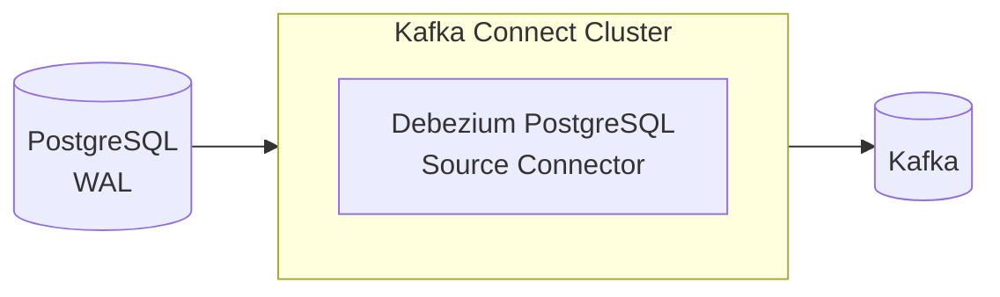

# ADR-0008: Debezium for Change Data Capture

## Status

Accepted, amended in [PIN-534](https://linear.app/pintail-consulting/issue/PIN-534/wire-debezium-cdc-into-cqrs-for-all-services)

**Amended 2026-11-14 ([PIN-534](https://linear.app/pintail-consulting/issue/PIN-534/wire-debezium-cdc-into-cqrs-for-all-services), PIN-545):** This is a decision, not yet implemented: the connector config in `docker/debezium/connectors/` is still the one described under "Current implementation" at the end of this block.

- **JSON, not Avro.** Messages stay JSON strings. There is no Schema Registry, and the original "Enable Schema Registry for Avro serialization" principle no longer applies. The outbox `payload` column is already a JSON string, so outbox connectors pass it through with `StringConverter`. A JSON converter would encode it a second time, as an escaped string, and change what consumers receive. Topic names, keys and payloads stay as they are today.
- **One connector per service database:** `acme_identity`, `acme_customers`, `acme_notifications`, `acme_products` and `acme_carts`.
- **Order is deferred.** The order service owns `acme_orders`, has its own outbox and polling relay, and is not covered by PIN-534's sub-issues. Its existing connector (`acme-postgres-connector`) and relay stay until a separate issue moves order onto the outbox event router.
- **Snapshots.** Outbox connectors use `snapshot.mode` `no_data`, so their first start does not republish rows the services already sent. Product's connector uses `initial`, because its first snapshot loads the seeded catalog.
- **Registered automatically.** The local stack registers every connector when it starts, so nobody has to POST a config to the Connect REST API by hand.
- **Outbox event router.** Identity, customer, notification and shopping-cart connectors capture their `outbox` table and route rows with Debezium's outbox event router ([ADR-0004](0004-change-data-capture.md), [ADR-0022](0022-transactional-outbox-pattern.md)). The product connector captures the catalog tables directly.

**Current implementation (2026-10-21, PIN-386):** One Debezium connector config exists, `docker/debezium/connectors/postgres-connector.json`, and it is not registered automatically (`docker/debezium/connectors/README.md` gives the manual `curl` command). It differs from the example below: it is named `acme-postgres-connector`, captures only the `acme_orders` database with `topic.prefix` `acme`, connects as `postgres` with a plain-text password (no Vault reference), and uses `JsonConverter` rather than Avro with Schema Registry. There is no connector per service database. Services publish through outbox pollers or straight to Kafka instead (see ADR-0004's status note, [ADR-0041](0041-per-service-persistence-model.md) and [ADR-0042](0042-best-effort-event-publishing.md)).

## Context

Our architecture requires streaming database changes to Kafka without the dual-write problem (see ADR-0004). We need a Change Data Capture solution that:

- Captures PostgreSQL changes reliably from the transaction log
- Publishes changes to Kafka in near real-time
- Handles schema changes gracefully
- Supports exactly-once delivery semantics
- Provides monitoring and management capabilities

Candidates considered:
- **Debezium**: Leading open-source CDC platform with broad database support
- **Maxwell**: MySQL-focused, limited PostgreSQL support
- **AWS DMS**: Managed but less flexible and AWS-specific
- **Custom WAL reader**: Maximum control but significant development effort

## Decision

We will use **Debezium** running on Kafka Connect for all Change Data Capture requirements.

Architecture:



Connector configuration principles (amended 2026-11-14, PIN-534):
- One connector per service database for isolation
- Use `pgoutput` logical decoding plugin (built into PostgreSQL)
- Serialize as JSON strings. No Schema Registry.
- Outbox connectors skip the initial snapshot (`snapshot.mode`: `no_data`)
- Outbox connectors capture only the `outbox` table and route it with the outbox event router, so topics, keys and payloads match what consumers already read
- Register connectors automatically when the local stack starts

Example connector configuration for an outbox service (illustrative: the column names follow customer's outbox table, which shopping-cart's matches, and the configs will live in `docker/debezium/connectors/`):
```json
{
  "name": "identity-service-connector",
  "config": {
    "connector.class": "io.debezium.connector.postgresql.PostgresConnector",
    "database.hostname": "postgres",
    "database.port": "5432",
    "database.user": "debezium",
    "database.password": "${vault:secret/debezium:password}",
    "database.dbname": "acme_identity",
    "topic.prefix": "identity",
    "plugin.name": "pgoutput",
    "slot.name": "identity_slot",
    "publication.name": "identity_publication",
    "table.include.list": "public.outbox",
    "key.converter": "org.apache.kafka.connect.storage.StringConverter",
    "value.converter": "org.apache.kafka.connect.storage.StringConverter",
    "snapshot.mode": "no_data",
    "transforms": "outbox",
    "transforms.outbox.type": "io.debezium.transforms.outbox.EventRouter",
    "transforms.outbox.table.field.event.id": "event_id",
    "transforms.outbox.table.field.event.key": "message_key",
    "transforms.outbox.table.field.event.payload": "payload",
    "transforms.outbox.route.by.field": "topic",
    "transforms.outbox.route.topic.replacement": "${routedByValue}"
  }
}
```

## Consequences

### Positive

- **Reliability**: Captures every committed transaction without data loss
- **Low Latency**: Changes streamed within milliseconds of commit
- **No Application Changes**: Works at database level, transparent to application
- **Schema Awareness**: Captures DDL changes and schema evolution
- **Monitoring**: Exposes JMX metrics for operational visibility
- **Ecosystem**: Part of broader Kafka Connect ecosystem with many transforms

### Negative

- **Infrastructure Dependency**: Adds Kafka Connect cluster to manage
- **Replication Slot Management**: Must monitor to prevent WAL bloat
- **Learning Curve**: Connector configuration requires understanding of CDC concepts
- **Resource Usage**: Additional memory for Connect workers

### Mitigations

- Monitor replication slot lag with alerts (e.g., lag > 100MB)
- Use heartbeat events to keep slots active during low-traffic periods
- Test connector configuration in staging before production deployment
- Document connector setup and common troubleshooting procedures
