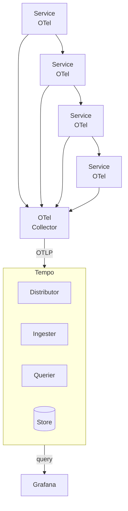

# ADR-0014: Tempo for Distributed Tracing

## Status

Accepted

**Current state (2026-10-21, PIN-386):** Tempo runs, with OTLP receivers on 4317 (gRPC) and 4318 (HTTP), but no backend service sends it traces. Linear PIN-370 ("Backend services send no traces to Tempo") tracks this. Every service declares `micrometer-tracing-bridge-otel` and `opentelemetry-exporter-otlp`, and `docker-compose.apps.yml` sets `OTEL_EXPORTER_OTLP_ENDPOINT=http://tempo:4317` for every service except order. No `application.yml` sets any `management.tracing` or `management.otlp` property, though. Order's built jar has no Spring Boot tracing auto-configuration module, only `spring-boot-micrometer-metrics` and `spring-boot-micrometer-observation`. There is no OpenTelemetry Collector either; the diagram below shows the intended design.

## Context

In a microservices architecture, a single user request may traverse multiple services. Understanding request flow requires distributed tracing that:

- Tracks requests across service boundaries with minimal overhead
- Correlates traces with logs and metrics for unified observability
- Provides latency breakdown by service and operation
- Supports sampling strategies for high-traffic systems
- Integrates with our Grafana-based observability stack

Candidates considered:
- **Tempo**: Grafana's distributed tracing backend, cost-effective storage
- **Jaeger**: CNCF project, established but requires additional storage
- **Zipkin**: Mature but less active development
- **AWS X-Ray**: AWS-specific, limited cross-cloud support

## Decision

We will use **Grafana Tempo** for distributed tracing.

Architecture:



Instrumentation strategy:
- **OpenTelemetry SDK**: Standard instrumentation for all services
- **Auto-instrumentation**: Spring Boot auto-configuration for common libraries
- **Context Propagation**: W3C Trace Context headers between services

Span attributes:
```
span.name: "POST /api/orders"
service.name: "order-service"
http.method: "POST"
http.url: "http://order-service/api/orders"
http.status_code: 201
db.system: "postgresql"
db.operation: "INSERT"
messaging.system: "kafka"
messaging.destination: "order.events"
```

Sampling configuration:
- Development: 100% sampling for debugging
- Production: Tail-based sampling (always sample errors, slow requests)
- Configurable rate limits to prevent overwhelming storage

## Consequences

### Positive

- **Cost Efficient**: Object storage backend keeps costs low at scale
- **Grafana Integration**: Native exemplar support links metrics to traces
- **OpenTelemetry Native**: First-class OTLP support
- **Trace Discovery**: TraceQL for finding traces by attributes
- **Correlations**: Link traces to logs (via trace ID) and metrics (via exemplars)

### Negative

- **No Trace Indexing**: Requires trace ID for retrieval (use TraceQL for discovery)
- **Sampling Trade-offs**: Head-based sampling may miss important traces
- **Newer Project**: Less mature than Jaeger/Zipkin

### Mitigations

- Use tail-based sampling via OpenTelemetry Collector to capture errors
- Propagate trace IDs to logs for trace discovery via log search
- Store trace IDs in error responses for user-reported issues
- Monitor collector and Tempo resource usage
